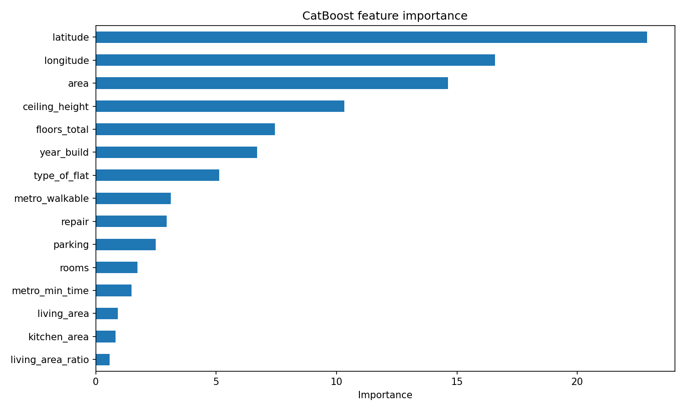
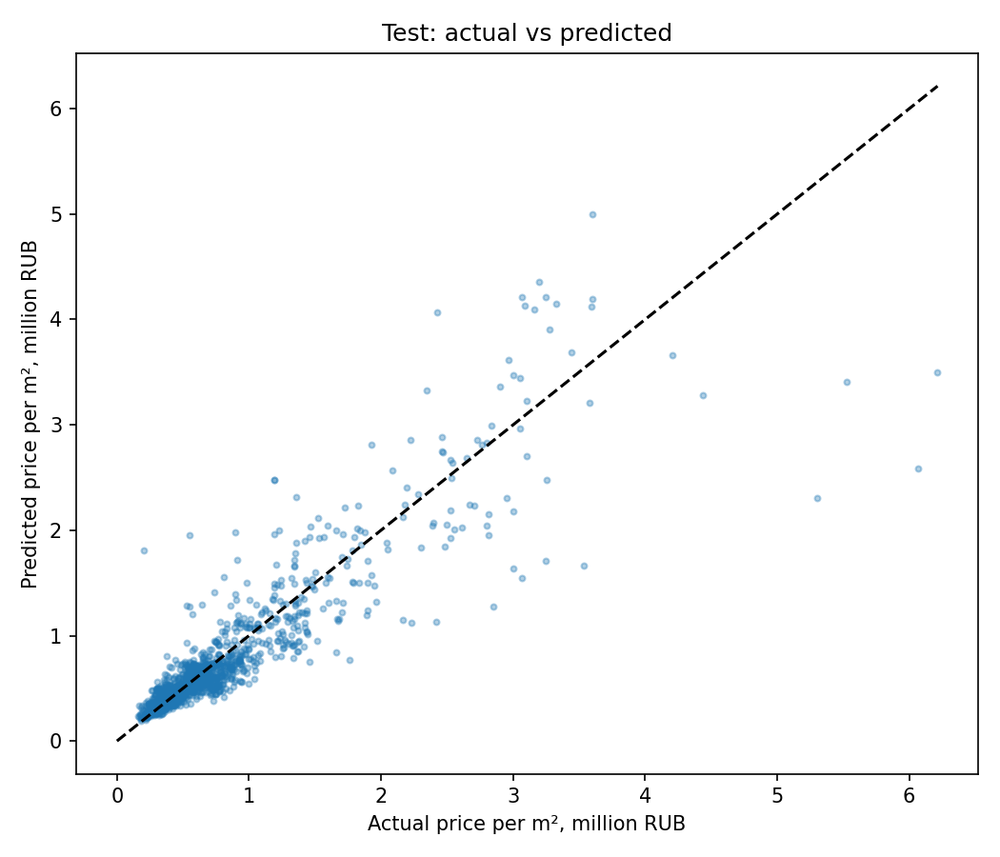
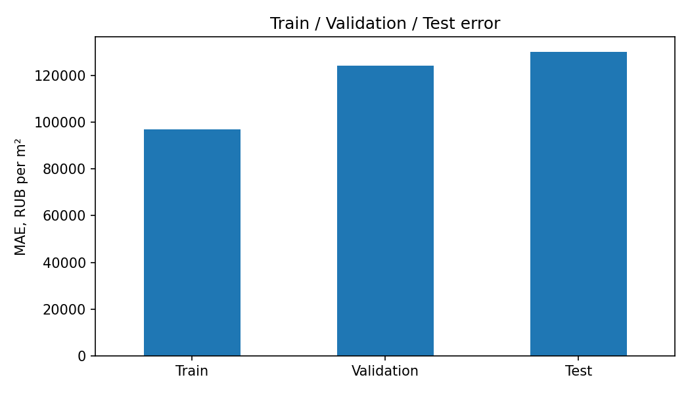

# CIAN: парсер объявлений и прогноз цен квартир

Проект объединяет сбор объявлений о продаже недвижимости с ЦИАН и модель машинного обучения для оценки стоимости квартир. Парсер получает характеристики объявлений, а модель CatBoost пытается предсказать цену квадратного метра по площади, координатам, этажу, типу дома и другим параметрам.

Данные относятся к объявлениям по Москве и Московской области. Модель оценивает **цену предложения**, а не подтвержденную стоимость сделки.

## Парсер

Парсер собирает ID объявлений со страниц поиска, запрашивает подробную информацию об объектах, выделяет цену и характеристики квартир. Предусмотрены экспорт результатов в CSV/JSON и построение тепловой карты стоимости квадратного метра по территории с разбиением на гексагоны.


ЦИАН может ограничивать автоматические запросы. В исходном парсере предусмотрены задержки между запросами; доступность сбора зависит от состояния сайта. Для обучения модели я использовала уже собранный ранее датасет, поэтому повторно запускать парсер не требуется.

## Модель предсказания цен

**Основной файл:** [`model.py`](model.py)

Моя ML-часть построена на `CatBoostRegressor`, то есть градиентном бустинге над решающими деревьями. Модель предсказывает стоимость одного квадратного метра, затем общую оценку квартиры можно получить умножением результата на площадь.

### Подготовка данных

- Удаление поврежденных записей, повторных заголовков и объявлений о долях.
- Удаление повторных объявлений по ID с сохранением наиболее свежей записи.
- Очистка числовых значений и проверка корректности площади, цены, этажности и координат.
- Отдельная обработка студий и пропущенных характеристик.
- Выделение информации о метро и создание дополнительных признаков: относительный этаж, доля жилой площади и доля кухни.

Всего используется 20 признаков, включая числовые и категориальные. Входные данные ожидаются в `offers.csv` рядом с `model.py`.

### Обучение и защита от переобучения

Данные делятся на Train, Validation и Test через `GroupShuffleSplit`. Квартиры с одинаковыми координатами, округленными до четырех знаков, не попадают одновременно в разные выборки, а группируются. Разбиение происходит на этих группах в соотношении 60/20/20 для обучения, валидации и теста соответственно. Это уменьшает вероятность слишком простой проверки на почти одинаковых объектах.

Для обучения используется логарифм цены квадратного метра. Сложность CatBoost контролируется глубиной дерева, L2-регуляризацией, скоростью обучения и ранней остановкой по Validation. Test не передается модели для выбора лучшей итерации.

Качество измеряется с помощью MAE, RMSE, R² и MAPE. Дополнительно используется базовый прогноз медианной цены квадратного метра для сравнения со сложной моделью.

### Результаты

| Метрика | Train | Validation | Test |
|---|---:|---:|---:|
| R² | 0.895 | 0.751 | 0.802 |
| MAE, руб./м² | 97 030 | 124 075 | 130 024 |
| RMSE, руб./м² | 234 067 | 254 215 | 269 095 |
| MAPE | 11.62% | 16.00% | 16.82% |

Это результаты одного группового разбиения уже собранного датасета. Они не означают, что модель гарантированно оценивает любую квартиру с такой точностью. Отдельные дорогие и необычные объекты предсказываются заметно хуже.

### Графики

**Важность признаков**



**Реальные и предсказанные цены квадратного метра**



**Сравнение ошибок на Train, Validation и Test**



Численные результаты также сохранены в [`reports/model_metrics.csv`](reports/model_metrics.csv) и [`reports/feature_importance.csv`](reports/feature_importance.csv).

## Структура проекта

- `main.py`, `parsers/`, `connection/`, `models/`, `utils/` - исходная часть парсера.
- `heatmap/` - код визуализации данных на карте.
- `model.py` - очистка датасета, обучение и оценка CatBoost.
- `reports/` - графики, метрики и таблица отдельных прогнозов.
- `LICENSE` - лицензия исходного парсера.

## Как запустить модель

Установить библиотеки для ML-части:

```bash
python -m pip install pandas numpy matplotlib scikit-learn catboost
```

Положить `offers.csv` в корень проекта и запустить:

```bash
python model.py
```

После запуска будут сохранены графики, таблицы и обученная модель `real_estate_model_v2.cbm`.

В коде есть функция `predict_new_apartment(model)` для ручного ввода параметров квартиры. В текущей версии репозитория она определена, но не вызывается автоматически из `main()`.

Исходный CSV не включен в репозиторий. Без него модель нельзя переобучить с нуля. Описание сбора данных и запуска парсера можно посмотреть в [исходном репозитории](https://github.com/Annnnzzzz/cian-sales-parser).

## Ограничения

Модель обучена на исторических ценах объявлений, а не фактических сделок. Разбиение по округленным координатам не гарантирует идеального разделения по зданиям. Оценка новых квартир может быть менее надежной для редких планировок, дорогой недвижимости и объектов за пределами обучающего датасета. Модель была обучена на небольшом объеме данных (чуть больше 8000 объявлений), поэтому часто случаются расхождения и ошибки.
